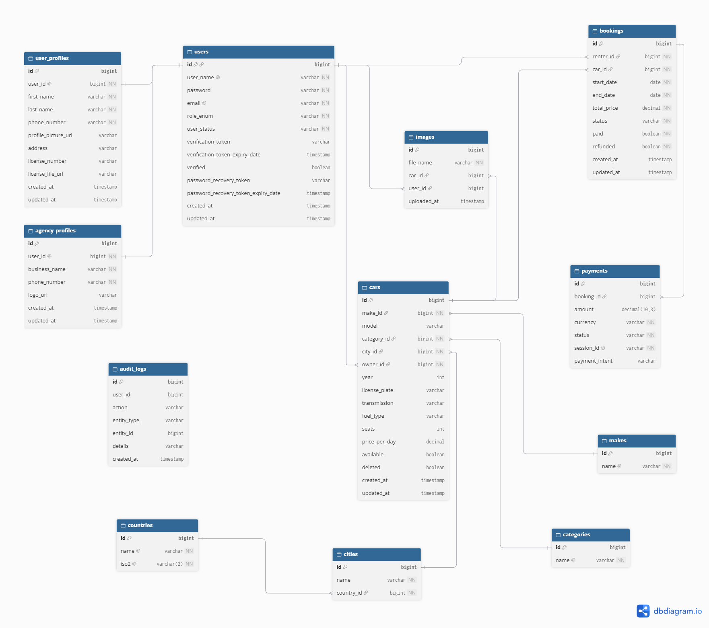

# RentRide

**A car rental platform built as event-driven Spring Boot microservices, deployed on AWS with Terraform and a Jenkins CI/CD pipeline.**

Agencies list their cars, customers search, book and pay for them online, and administrators oversee the whole platform. The system is split into six independently deployable services that communicate over REST and Apache Kafka. A React single-page application sits in front of them.

**Live demo:** https://d3lwgdw2frxsbt.cloudfront.net

---

## Table of Contents

1. [Features](#features)
2. [Technology Stack](#technology-stack)
3. [System Architecture](#system-architecture)
4. [Services](#services)
5. [Event-Driven Communication](#event-driven-communication)
6. [Data Model](#data-model)
7. [Security](#security)
8. [Concurrency and Data Consistency](#concurrency-and-data-consistency)
9. [Repository Structure](#repository-structure)
10. [Getting Started](#getting-started)
11. [Configuration](#configuration)
12. [API Documentation](#api-documentation)
13. [Testing](#testing)
14. [CI/CD Pipeline](#cicd-pipeline)
15. [Cloud Infrastructure](#cloud-infrastructure)
16. [Monitoring and Logging](#monitoring-and-logging)
17. [Challenges](#challenges)
18. [Unsolved Problems](#unsolved-problems)
19. [Future Improvements](#future-improvements)
20. [Further Documentation](#further-documentation)
21. [Credits and External Resources](#credits-and-external-resources)

---

## Features

### Customers
- Register, verify their email address, log in, and recover or change their password.
- Manage a profile and a profile picture.
- Search cars with filters that can be combined: country, city, category, make, price range, seats, transmission, fuel type, and **availability between two dates**.
- See a calendar of each car's booked dates, and request a booking (the price is calculated automatically).
- Pay approved bookings through **Stripe Checkout**. Cancelling a paid booking refunds it automatically.
- Receive real-time notifications over Server-Sent Events, and view their own bookings and payment history.

### Agencies
- Register and wait for administrator approval before they can log in.
- Manage an agency profile and logo.
- Create, update and remove car listings, and upload car images.
- Approve, reject or cancel the booking requests on their cars, and view the payments they received.

### Administrators
- Approve agencies, and activate or deactivate any account.
- Search users, bookings and payments with filters and pagination.
- Manage the car catalogue (makes and categories).
- Browse the platform-wide audit log.

### Platform
- Scheduled jobs complete finished bookings and expire requests that were never answered.
- Every service returns the same JSON error format.
- Rate limiting on login and registration.
- Seed data for demos: an admin, a test agency and customer, sample cars with photos, and bookings in every status.

---

## Technology Stack

| Layer | Technologies |
|---|---|
| **Backend** | Java 21, Spring Boot 4, Spring Security (JWT), Spring Data JPA / Hibernate, Bean Validation, Lombok |
| **Messaging** | Apache Kafka 4 (KRaft mode, no ZooKeeper), Spring for Apache Kafka |
| **Database** | PostgreSQL 17 |
| **Payments** | Stripe Checkout, Stripe webhooks, Stripe refunds |
| **Email** | Spring Mail over SMTP (Mailtrap in non-production environments) |
| **Frontend** | React, TypeScript, Vite, React Router |
| **API docs** | springdoc-openapi (Swagger UI) |
| **Testing** | JUnit 5, Mockito, Cucumber (BDD) |
| **Containers** | Docker (multi-stage builds), Docker Compose |
| **CI/CD** | Jenkins (declarative pipeline), Amazon ECR, AWS Systems Manager Run Command |
| **Infrastructure as Code** | Terraform (AWS provider 6) |
| **Cloud** | AWS: VPC, EC2, RDS, ECR, S3, CloudFront, SSM Parameter Store, IAM, CloudWatch, SNS |

---

## System Architecture

```
                         ┌──────────────────────────┐
     Browser ──────────▶ │        CloudFront        │
                         └─────┬──────────────┬─────┘
                  static files │              │ /api/*
                               ▼              ▼
                      ┌──────────────┐   ┌───────────────────────────── EC2 (Docker Compose) ──┐
                      │  S3 (React)  │   │                                                    │
                      └──────────────┘   │  user ─ car ─ booking ─ payment ─ notification ─ audit
                                         │    │      │      │        │          │          │   │
                                         │    └──────┴──────┴────┬───┴──────────┴──────────┘   │
                                         │                       ▼                             │
                                         │                 Apache Kafka                        │
                                         └───────────────────────┬─────────────────────────────┘
                                                                 │
                                                                 ▼
                                                     RDS PostgreSQL (private subnet)

            Stripe ── webhook ──▶ payment-service          SMTP (Mailtrap) ◀── user-service
```

### Design principles

- **One service per business capability.** Each service owns its domain logic and can be built, tested, containerised and deployed on its own.
- **Synchronous calls only when an answer is needed now.** A service uses REST (Spring `RestClient`) only when it needs a reply before it can respond. For example, booking-service asks car-service for a car's price and owner.
- **Asynchronous events for everything else.** Audit records, notifications and booking state changes are published to Kafka. A slow or unavailable consumer never blocks a user request.
- **A shared `common` module** holds the JWT filter, the security configuration, the global exception handler, the event contracts and the topic names. Every service applies the same rules in the same way.
- **CQRS read model.** car-service keeps its own projection of reservations, fed by booking events, so it can answer "which cars are free between these dates" without calling booking-service.
- **Stateless services.** Authentication is a signed JWT, so any instance of any service can serve any request.

---

## Services

| Service | Port | Responsibility | Main endpoints |
|---|---|---|---|
| **user-service** | 8081 | Accounts, authentication, email verification, password recovery, customer and agency profiles, user administration | `/users/**`, `/profiles/**` |
| **car-service** | 8082 | Car listings, images, search with filters and availability, makes, categories, countries and cities | `/cars/**`, `/images/**`, `/makes`, `/categories`, `/countries`, `/cities` |
| **booking-service** | 8083 | Booking lifecycle (request, approve, reject, cancel, complete), booked-date calendar, scheduled jobs, admin booking search | `/bookings/**` |
| **payment-service** | 8084 | Stripe Checkout sessions, the webhook, refunds, payment history | `/pay/**` |
| **notification-service** | 8085 | Real-time notifications pushed to connected users over Server-Sent Events | `/notifications/stream` |
| **audit-service** | 8086 | Central, append-only audit trail of important actions across the platform | `/audit-logs` |
| **common** | n/a | Shared library: security, JWT, exceptions, event records, topic names | n/a |

### Booking lifecycle

```
PENDING ──approve──▶ APPROVED ──pay──▶ APPROVED + paid ──end date passes──▶ COMPLETED
   │                    │                    │
   ├──reject──▶ REJECTED │                    └──cancel──▶ CANCELLED + refunded
   ├──cancel──▶ CANCELLED◀──cancel──┘
   └──pick-up date passes without an answer──▶ REJECTED (scheduled job)
```

---

## Event-Driven Communication

All events are JSON records defined once in `common/events` and shared by every service. Audit and booking events carry an `eventId` and an `occurredAt` timestamp. The audit consumers store the `eventId` and skip any event they have already recorded, so redelivered messages never create duplicate entries.

| Topic | Produced by | Consumed by | Purpose |
|---|---|---|---|
| `audit-events` | every service | audit-service | Records who did what, and when |
| `notification-events` | payment-service | notification-service | Direct messages to a specific user |
| `booking-events` | booking-service | car-service, notification-service, audit-service | Booking state changes. These feed car-service's reservation read model, live notifications and the audit trail |

Kafka runs in **KRaft mode** with two listeners: an internal one for containers and an external one for tools on the host.

---

## Data Model



The entities are split by ownership (database-per-service pattern):

- **user-service:** User, UserProfile, AgencyProfile
- **car-service:** Car, Image, Make, Category, Country, City, CarReservation (read model)
- **booking-service:** Booking
- **payment-service:** Payment
- **audit-service:** AuditLog

Services never join across another service's tables. They refer to each other's data by id only.

---

## Security

- **JWT authentication.** user-service issues a signed token at login. Every other service validates it locally with the shared filter, so no call to user-service is needed per request.
- **Role-based access control** with three roles (`CUSTOMER`, `AGENCY`, `ADMIN`), enforced with `@PreAuthorize`. Ownership is checked as well: for example, only the agency that owns a car can approve its bookings.
- **Account states.** Unverified emails cannot log in. A new agency stays `UNAPPROVED_AGENCY` until an administrator approves it, and deactivated accounts are locked.
- **Service-to-service calls.** Internal endpoints (for example, marking a booking as paid) are protected with an internal API key and are not exposed to end users.
- **Stripe webhooks** are verified with Stripe's signature before they are processed.
- **Uploads are validated by their content.** Each file's magic bytes are checked, it is stored under a random UUID, and path traversal is prevented.
- **Secrets are kept out of the repository.** Locally they live in per-service `.env` files, which git ignores. In AWS they are SSM Parameter Store SecureStrings, read by the instance's IAM role at deploy time.
- **Infrastructure hardening.** The database sits in a private subnet with no public access. The instance requires IMDSv2. There is no SSH, because deployments use SSM Run Command. ECR scans every image on push.

---

## Concurrency and Data Consistency

| Workflow | Risk | Safeguard |
|---|---|---|
| Approving bookings | Two overlapping bookings approved at the same moment would double-book the car | Per-car lock that makes "check availability, then save" atomic. The loser receives **409 Conflict** |
| Starting a payment | A double click would create two Stripe sessions | Pessimistic row lock (`SELECT … FOR UPDATE`) on the booking inside the transaction |
| Refunds | A retry would refund twice | Stripe **idempotency key** per booking |
| Scheduled jobs | A job overwrites a booking a user changed a moment earlier | Single conditional bulk `UPDATE … WHERE status = …`, re-checked by the database |
| Kafka consumers | The same event delivered twice | The audit trail is deduplicated on `eventId` |

Notifications and emails run on dedicated `@Async` thread pools with bounded queues, so slow external systems never delay API responses. The full analysis is in [docs/race-condition.md](docs/race-condition.md).

---

## Repository Structure

```
.
├── common/                 Shared library (security, JWT, exceptions, Kafka event contracts)
├── user-service/           Spring Boot service, port 8081
├── car-service/            Spring Boot service, port 8082
├── booking-service/        Spring Boot service, port 8083 (includes the Cucumber suite)
├── payment-service/        Spring Boot service, port 8084
├── notification-service/   Spring Boot service, port 8085
├── audit-service/          Spring Boot service, port 8086
├── frontend/               React + TypeScript single-page application
├── Dockerfile              One multi-stage Dockerfile, parameterised per service
├── docker-compose.yml      Full local stack: PostgreSQL, Kafka and the six services
├── deploy/                 Production compose file and the on-instance deploy script
├── infra/                  Terraform for the complete AWS environment
├── jenkins/                Jenkins controller image (Docker, AWS CLI, Node.js)
├── scripts/release.sh      Build → push to ECR → deploy to EC2 → publish frontend
├── Jenkinsfile             CI/CD pipeline definition
└── docs/                   Deployment guide, planning, ERD, concurrency write-up
```

---

## Getting Started

### Prerequisites

| Tool | Version |
|---|---|
| Docker Desktop (with Compose v2) | latest |
| Node.js | 18 or newer (frontend only) |
| JDK | 21 (only to run services outside Docker) |
| Stripe CLI | optional, to receive payment webhooks locally |

Maven does not need to be installed, because each module ships the Maven wrapper.

### 1. Clone

```bash
git clone https://github.com/Yahya-352/project2-RentalSystem.git
cd project2-RentalSystem
```

### 2. Configure secrets

Create a `.env` file in each service folder with the variables listed in [Configuration](#configuration). git ignores these files.

### 3. Start the backend

```bash
docker compose up -d --build
```

This starts PostgreSQL, Kafka and all six services. Each service waits until the database and the broker are healthy. Check the stack with:

```bash
docker compose ps
docker compose logs -f booking-service
```

### 4. Start the frontend

```bash
cd frontend
npm install
npm run dev
```

Open **http://localhost:5173**. In development, the Vite proxy routes each `/api/<path>` call to the service that owns it, so the browser only ever talks to one origin.

### 5. Receive Stripe webhooks (optional)

```bash
stripe listen --forward-to localhost:8084/pay/webhook
```

Pay with the test card `4242 4242 4242 4242`, any future expiry date and any CVC.

### Seeded accounts

On first start, user-service creates an administrator from `ADMIN_USERNAME` and `ADMIN_PASSWORD`. It also creates a verified test customer (`customer@rental.com`) and a verified test agency (`agency@rental.com`), whose password is `SEED_PASSWORD`. Seeding only adds missing data, so restarts are safe.

---

## Configuration

Each service reads an optional `.env` file from its working directory (`spring.config.import=optional:file:.env`). Environment variables override it.

| Variable | Used by | Description |
|---|---|---|
| `DB_USERNAME`, `DB_PASSWORD` | all services | PostgreSQL credentials |
| `JWT_SECRET` | all services | Base64-encoded signing key (at least 32 bytes once decoded); must be identical in every service |
| `ADMIN_USERNAME`, `ADMIN_PASSWORD` | user | The administrator account created on first start |
| `SEED_PASSWORD` | user | Password of the seeded demo customer and agency |
| `SMTP_USERNAME`, `SMTP_PASSWORD` | user | Mail server credentials |
| `FRONTEND_URL` | user, payment | Base URL for email links and Stripe redirects |
| `INTERNAL_API_KEY` | booking, payment | Shared key for internal service-to-service endpoints |
| `STRIPE_TEST_SECRET_KEY` | payment | Stripe secret key (`sk_test_…`) |
| `STRIPE_WEB_HOOK_SECRET` | payment | Stripe webhook signing secret (`whsec_…`) |

Docker Compose supplies the connection URLs (`SPRING_DATASOURCE_URL`, `SPRING_KAFKA_BOOTSTRAP_SERVERS`, `CARSERVICE_URL`, and so on). In AWS, every value comes from SSM Parameter Store under `/rentride/app/*`.

Generate a JWT secret with:

```bash
openssl rand -base64 48
```

---

## API Documentation

Every service publishes interactive OpenAPI documentation:

| Service | Swagger UI |
|---|---|
| user-service | http://localhost:8081/swagger-ui/index.html |
| car-service | http://localhost:8082/swagger-ui/index.html |
| booking-service | http://localhost:8083/swagger-ui/index.html |
| payment-service | http://localhost:8084/swagger-ui/index.html |
| notification-service | http://localhost:8085/swagger-ui/index.html |
| audit-service | http://localhost:8086/swagger-ui/index.html |

To call protected endpoints:
1. Call `POST /users/login`.
2. Click **Authorize** and paste the returned token.

Errors use one consistent body across all services:

```json
{
  "timestamp": "2026-11-21T10:15:30",
  "status": 409,
  "error": "Conflict",
  "message": "Car is not available at this date",
  "path": "/bookings/42/approve"
}
```

---

## Testing

```bash
# Build the shared module first, then test any service
./mvnw -f common install -DskipTests
./mvnw -f booking-service verify
```

| Type | Location | What it covers |
|---|---|---|
| Unit tests | `*/src/test/java/**/service` | Business rules with mocked collaborators (JUnit 5 + Mockito) |
| Concurrency test | `BookingConcurrencyTest` | Parallel approvals of overlapping bookings; exactly one succeeds |
| BDD acceptance tests | `booking-service/src/test/resources/features/booking.feature` | Ten Cucumber scenarios covering the booking lifecycle, validation, authorisation and conflicts |

The pipeline runs every suite on each push and publishes the JUnit reports in Jenkins.

---

## CI/CD Pipeline

The `Jenkinsfile` defines a declarative pipeline that checks the repository every two minutes and runs on every new commit to `main`:

```
Checkout ─▶ Build common ─▶ Test services (parallel) ─▶ Publish JUnit reports ─▶ Build images ─▶ Deploy to AWS
```

The **Deploy to AWS** stage runs `scripts/release.sh`, which:

1. Builds the six service images for `linux/amd64` and tags them with the build's commit.
2. Pushes them to **Amazon ECR**, where tags are immutable and every image is scanned for vulnerabilities.
3. Sends the production compose file and `deploy/deploy.sh` to the EC2 instance through **SSM Run Command**. The script loads secrets from Parameter Store, pulls the new images and restarts the stack.
4. Builds the React app, syncs it to **S3** and invalidates the **CloudFront** cache.

Jenkins authenticates with an IAM role, so no long-lived AWS keys are stored in the pipeline. A manual `DEPLOY` parameter allows on-demand releases.

---

## Cloud Infrastructure

The whole AWS environment is defined in Terraform under [`infra/`](infra/) and can be created or destroyed with a single command.

| File | Resources |
|---|---|
| `vpc.tf`, `security.tf` | VPC, public and private subnets, routing, security groups |
| `rds.tf` | PostgreSQL 17 in a private subnet, encrypted storage, generated password |
| `ec2.tf`, `user_data.sh` | Amazon Linux 2023 host with Docker, Compose, swap and log shipping (IMDSv2 enforced) |
| `iam.tf` | Instance role: SSM access, ECR read access, scoped Parameter Store and CloudWatch Logs access |
| `ecr.tf` | One repository per service, with scan on push, immutable tags and lifecycle cleanup |
| `ssm.tf` | Application secrets stored as SecureString parameters |
| `frontend.tf`, `cloudfront.tf` | Static frontend hosting. CloudFront serves the SPA over HTTPS and routes `/api/*` to the services |
| `monitoring.tf` | CloudWatch log group, error metric filter, alarms and optional email alerts through SNS |

```bash
cd infra
cp terraform.tfvars.example terraform.tfvars   # fill in the secrets
terraform init
terraform apply
```

The step-by-step guide is in [docs/DEPLOYMENT.md](docs/DEPLOYMENT.md).

---

## Monitoring and Logging

- **Centralised logs.** All container logs are shipped to the CloudWatch log group `/rentride/app`.
- **Error alerting.** A metric filter counts `ERROR` lines, and an alarm fires when errors appear.
- **Infrastructure alarms** watch high EC2 CPU and failed instance status checks.
- **Notifications.** Alarms can email the on-call address through SNS (`alert_email`).
- **Audit trail.** Business-level actions are queryable through the audit-service and the admin UI.

---

## Challenges

- **AWS account not activated in time.** The AWS account was not activated when the infrastructure work started. The Terraform code was written and checked without an account (`terraform validate`, `terraform plan` against the provider schema), so it could be applied unchanged once an account was available.
- **Slow pushes to ECR.** Pushing the six Java images from a home connection timed out repeatedly, because the base layers are about 130 MB each and the upload speed was below 0.5 MB/s. The images are now built and pushed from inside AWS by the Jenkins server, where the network is fast. Only the small frontend build leaves the developer's machine.
- **Stripe worked locally but not on AWS.** Locally, `stripe listen` forwards webhook events to `localhost`, so payments were marked as paid. On AWS nothing forwarded them, so bookings stayed unpaid. The fix was to register a webhook endpoint in the Stripe Dashboard pointing to the public URL (`/api/pay/webhook`) and store its signing secret in SSM Parameter Store. This is now solved.

---

## Unsolved Problems

- **Late returns are not handled.** A scheduled job marks a booking `COMPLETED` once its end date passes, whether or not the car was actually returned. There is no way to record a late return, and no late fee is charged.
- **Deactivated accounts keep working until their token expires.** Services validate the JWT locally and do not check the account's status on each request. When an administrator deactivates a user, that user's existing token is still accepted until it expires.
- **No caching.** Data that rarely changes (makes, categories, countries, cities) is read from the database on every request, and car search results are not cached either.

---

## Future Improvements

| Area | Current state | Planned improvement |
|---|---|---|
| Booking approval lock | In-memory lock, correct for a single instance per service | Database-level lock for horizontal scaling |
| Rate limiting | In-memory counters per instance | Shared store such as Redis |
| Kafka error handling | Retries are left to the client defaults | Retry topics with a dead-letter topic |
| Hosting | Single EC2 host running Docker Compose | Container orchestration (ECS or EKS) with auto scaling and a load balancer |
| Gateway | CloudFront routes paths to services | Dedicated API gateway with central authentication and throttling |
| Observability | Logs and alarms | Distributed tracing and metrics dashboards |

---

## Further Documentation

- [Deployment guide](docs/DEPLOYMENT.md): AWS setup, release process, Jenkins, troubleshooting
- [Concurrency analysis](docs/race-condition.md): race conditions and how each one is prevented
- [Project planning](docs/planning.md): scope, phases and timeline
- [Frontend](frontend/README.md): structure and development of the React app
- [User stories (Jira)](https://yahya-altaraifi.atlassian.net/jira/core/projects/RR/board?filter=&groupBy=none)

---

## Credits and External Resources

### Microservices, Kafka and Terraform

| Resource | URL | Used for |
|---|---|---|
| Microservices (James Lewis and Martin Fowler) | https://martinfowler.com/articles/microservices.html | Understanding microservice characteristics and splitting the monolith |
| Decompose by business capability (microservices.io) | https://microservices.io/patterns/decomposition/decompose-by-business-capability.html | Choosing the service boundaries (users, cars, bookings, payments, notifications, audit) |
| Database per service (microservices.io) | https://microservices.io/patterns/data/database-per-service.html | Data ownership: each service owns its tables and refers to others by id only |
| CQRS (microservices.io) | https://microservices.io/patterns/data/cqrs.html | The car reservations read model in car-service, fed by booking events |
| REST Clients (Spring Framework reference) | https://docs.spring.io/spring-framework/reference/integration/rest-clients.html | Synchronous service-to-service calls with `RestClient` |
| Spring for Apache Kafka (reference) | https://docs.spring.io/spring-kafka/reference/ | Producers, `@KafkaListener` consumers and JSON serialisation of events |
| Terraform AWS Provider (HashiCorp Registry) | https://registry.terraform.io/providers/hashicorp/aws/latest/docs | Writing the AWS infrastructure (VPC, EC2, RDS, ECR, S3, CloudFront, SSM, CloudWatch) |

### Earlier projects

- Country and city data: [countries-states-cities-database](https://github.com/dr5hn/countries-states-cities-database) by dr5hn, licensed under the [ODbL](https://opendatacommons.org/licenses/odbl/), filtered to the GCC countries.
- Sample car photos from [Wikimedia Commons](https://commons.wikimedia.org), resized to 1280 px wide:
  - Toyota Corolla: [photo 1](https://commons.wikimedia.org/wiki/File:Toyota_Corolla_sedan_E210_hydrid.jpg) by Mateusmatsuda (CC BY 4.0), [photo 2](https://commons.wikimedia.org/wiki/File:TOYOTA_COROLLA_SEDAN_(E210)_China.jpg) by Dinkun Chen (CC BY-SA 4.0)
  - Hyundai Tucson: [photo 1](https://commons.wikimedia.org/wiki/File:Hyundai_Tucson_(NX4)_1X7A0424.jpg) by Alexander Migl, [photo 2](https://commons.wikimedia.org/wiki/File:Hyundai_Tucson_(NX4,_SWB)_IMG_9135.jpg) by Alexander-93 (CC BY-SA 4.0)
  - Nissan Altima: [photo 1](https://commons.wikimedia.org/wiki/File:NISSAN_ALTIMA_(L34)_China_(3).jpg), [photo 2](https://commons.wikimedia.org/wiki/File:NISSAN_ALTIMA_(L34)_China_(5).jpg) by Dinkun Chen (CC BY-SA 4.0)
  - Tesla Model 3: [photo 1](https://commons.wikimedia.org/wiki/File:Tesla_Model_3_(2023)_IMG_9488_(cropped).jpg) by Alexander-93, [photo 2](https://commons.wikimedia.org/wiki/File:Tesla_Model_3,_EMS_2024,_Essen_(P1032260).jpg) by Matti Blume (CC BY-SA 4.0)
  - Kia Carnival: [photo 1](https://commons.wikimedia.org/wiki/File:KIA_CARNIVAL_(KA4)_China_(5).jpg) by Dinkun Chen, [photo 2](https://commons.wikimedia.org/wiki/File:Kia_Carnival_KA4_PE_1.6T_EX_HEV_Snowflake_White_Pearl.jpg) by Ethan Llamas (CC BY-SA 4.0)
  - BMW Z4: [photo 1](https://commons.wikimedia.org/wiki/File:BMW_G29_Z4_M40i_(Facelift)_1X7A6946.jpg) by Alexander-93, [photo 2](https://commons.wikimedia.org/wiki/File:BMW_Z4_(G29,_facelift)_M40i_DSC_7273.jpg) by Alexander Migl (CC BY-SA 4.0)
- [Stripe documentation](https://docs.stripe.com) for Checkout, webhooks and idempotent requests.
