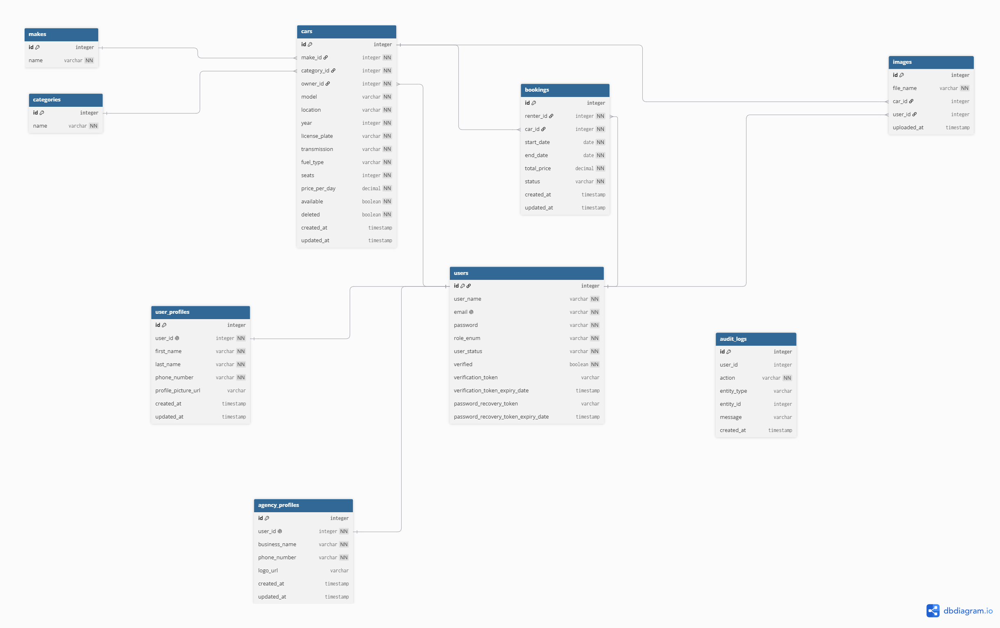

# RentRide

RentRide is a REST API for renting cars, where customers book cars, agencies list and manage them, and admins oversee the platform.

## Table of Contents

1. [Project Information](#project-information)
2. [Technologies](#technologies)
3. [Architecture](#architecture)
4. [General Approach](#general-approach)
5. [User Stories](#user-stories)
6. [ERD](#erd)
7. [Planning](#planning)
8. [Project 3 Changes](#project-3-changes)
9. [API Documentation](#api-documentation)
10. [Installation](#installation)
11. [Unsolved Problems](#unsolved-problems)
12. [Major Challenges](#major-challenges)
13. [Future Improvements](#future-improvements)
14. [External Resources](#external-resources)

---

## Project Information

### Description

RentRide is a backend REST API built with Spring Boot. It lets agencies publish cars for rent, lets customers search for cars and book them for a date range, and gives admins the tools to approve agencies and manage user accounts. Access is protected with JWT authentication and three roles: customer, agency and admin.

### Application Purpose

Renting a car usually means calling several agencies and checking availability by hand. This application puts the whole flow in one place:

- Agencies publish their cars and decide which booking requests to accept.
- Customers browse the available cars, request a booking for specific dates, and get notified when the agency answers.
- Admins keep the platform safe by approving new agencies and deactivating accounts when needed.

### Main Features

**Customers**
- Register, verify their email address, and log in
- Create and update a profile, and upload a profile picture
- Browse cars with pagination, filtered by location, category or make
- Book a car for a date range (the total price is calculated automatically)
- View their own bookings and cancel them
- Receive real-time booking notifications (Server-Sent Events)

**Agencies**
- Register, verify their email address, and wait for admin approval before they can log in
- Create and update an agency profile
- Create, update and delete car listings (deleted cars are hidden, not removed from the database)
- Upload car images (JPG or PNG)
- View the bookings made on their cars, and approve, reject or cancel them

**Admins**
- Activate and deactivate user accounts
- Approve pending agency accounts
- View all bookings, optionally filtered by status

**General**
- JWT authentication with role-based access control
- Email verification, password recovery and password change
- Booking rules: no bookings in the past, the start date must be before the end date, and approved bookings cannot overlap for the same car
- Audit log that records important actions (registration, approvals, bookings and so on)
- Consistent JSON error responses from a global exception handler
- Request rate limiting
- Database seeding for local testing
- Swagger / OpenAPI documentation

---

## Technologies

- Java 25
- Spring Boot 4.1.1
- Spring Security 7 with JWT (jjwt)
- Spring Data JPA / Hibernate 7
- PostgreSQL
- Maven
- Spring Mail (email verification and password recovery, tested with Mailtrap)
- Server-Sent Events (SSE) for real-time booking notifications
- Swagger / OpenAPI (springdoc)
- Lombok
- Bean Validation
- JUnit 5 and Mockito
- Git / GitHub

---

## Architecture

The application follows a standard layered architecture:

```
Client (Postman / Swagger)
        |
        v
  Controller layer   - HTTP endpoints, request validation, status codes
        |
        v
   Service layer     - business rules, authorization checks, audit logging
        |
        v
 Repository layer    - Spring Data JPA
        |
        v
    PostgreSQL
```

Requests and responses use DTOs (Java records), so the database entities are never exposed directly. Errors are thrown as custom exceptions in the service layer and translated into JSON responses by one global handler.

### Major Components

- **Security:** a JWT filter reads the token from the `Authorization` header, loads the user, and sets the authentication. Roles are enforced with `@PreAuthorize` on the controllers.
- **Global exception handling:** maps custom exceptions to HTTP statuses (400, 401, 403, 404, 409, 500) and returns the same JSON error body every time.
- **Agency approval:** a new agency gets the status `UNAPPROVED_AGENCY`. Spring Security treats that account as locked, so it cannot log in until an admin activates it.
- **Audit logging:** an audit service records who did what, for example registrations, approvals, bookings and car changes.
- **Notifications:** booking events are pushed to connected users over Server-Sent Events (`/notifications/stream`).
- **File storage:** car images and profile pictures are validated by their real content (not just the file name), renamed with a random UUID, and stored in the `uploads/` folder.
- **Rate limiting:** a filter limits repeated requests and returns 429 when the limit is exceeded.
- **Data seeding:** a startup component creates the admin, categories, makes and test accounts if they don't exist yet.

### Project Structure

```
src/main/java/com/ga/RentalSystem
├── config        - OpenAPI configuration, DataSeeder
├── controller    - REST controllers
├── dto
│   ├── request   - request records
│   └── response  - response records
├── enums         - Role, UserStatus, BookingStatus, FuelType, TransmissionType
├── exceptions    - custom exceptions and the global exception handler
├── model         - JPA entities (User, UserProfile, AgencyProfile, Car, Make, Category, Image, Booking, AuditLog)
├── repository    - Spring Data repositories
├── security      - JWT utilities and filter, user details, security configuration
└── service       - business logic
```

---

## General Approach

I built the project one feature at a time, and each feature was developed on its own Git branch and merged into `main` once it worked. Within a feature I always worked from the inside out: the entity and repository first, then the service with the business rules, and only then the controller. After each step I committed, so the history shows how the project grew.

The structure is deliberately simple. Controllers only receive the request and return the result, services contain all the rules, and repositories only talk to the database. Every rule that can fail throws a custom exception (not found, conflict, forbidden and so on), and a single global handler turns each one into the right HTTP status. That keeps the controllers short and the error responses consistent.

For the major features, authentication uses JWT with Spring Security. Registration creates an unverified user and sends an email with a verification link, and login is blocked until the email is verified. Agencies get one extra step: they start as `UNAPPROVED_AGENCY` and an admin has to approve them. Bookings start as `PENDING`, and the agency approves or rejects them. When approving, the service checks that no other approved booking overlaps the same dates, and the price is calculated from the number of days and the car's daily price. File uploads check the first bytes of the file to confirm it really is a JPG or PNG. Before the documentation step I did a cleanup pass so that every endpoint returns a DTO, and each endpoint returns a sensible status code (201 for creation, 204 for deletion and activation, 200 otherwise).

---

## User Stories

The user stories are grouped by role (customer, agency, admin) and system quality, and each one lists the endpoint that implements it.

[User stories (Jira board)](https://yahya-altaraifi.atlassian.net/jira/core/projects/RR/board?filter=&groupBy=none)

---

## ERD



---

## Planning

The planning document covers the scope, the deliverables by phase with their progress, the timeline, and the way of working.

[Planning document](docs/planning.md)

---

## Project 3 Changes

### New functionality
- **Combined car search:** city, country, category, make, price range, seats, transmission, fuel and **availability between two dates**, all optional and combined (JPA Specifications).
- **Booking calendar:** the taken dates of a car, so customers pick free days.
- **Stripe payments:** approved bookings are paid on Stripe Checkout; a webhook marks them paid.
- **Automatic refunds:** cancelling a paid booking refunds the full amount.
- **Scheduled jobs:** every day, finished bookings become `COMPLETED` and unanswered requests past their pick-up date become `REJECTED`.
- **More notifications and audit logs:** payment received, booking paid, payment failed, booking cancelled.

### New models
- **Country** and **City** (seeded from a JSON dataset); a car now belongs to a city instead of a free-text location.
- **Payment** (amount, currency, status `PENDING`/`PAID`/`FAILED`/`REFUNDED`, Stripe session and payment intent).
- **Booking** gained `paid` and `refunded`.

### Concurrency explanation
| Workflow | What could go wrong | How it is prevented | Why this approach |
|---|---|---|---|
| **Approving bookings** (`PATCH /bookings/{id}/approve`) | Two agency requests approve overlapping bookings at the same time → the car is double-booked | A `ReentrantLock` per car (`ConcurrentHashMap`) makes "check availability + save" one step; the loser gets **409** | Cheap, in-memory, and approvals of different cars don't block each other |
| **Paying** (`POST /pay/{bookingId}`) | A double click creates two Stripe sessions → the customer pays twice | A pessimistic DB lock on the booking row (`SELECT ... FOR UPDATE`) inside a transaction; the second request waits, then gets **409** | The payments don't exist yet, so the booking row is the lock; works across instances and rolls back with the transaction |
| **Refunding** | A retry after an error refunds twice | A Stripe **idempotency key** (`refund-booking-{id}`) | Stripe performs the same refund only once |
| **Scheduled jobs** | A job overwrites a booking that was just cancelled | One bulk `UPDATE ... WHERE status = ...`, which the database re-checks | No load-then-save gap in Java |

**Database consistency:** availability, payment and status rules are checked inside the lock or the transaction that writes, so a request never acts on stale data. Full write-ups: [docs/race-condition.md](docs/race-condition.md).

**Asynchronous processing:** emails and SSE notifications run with `@Async` on two separate thread pools, so a slow mail server never slows down a request:
- `emailExecutor` (2–4 threads, queue 100, `CallerRunsPolicy`: an email is never dropped, and the caller sends it when the pool is full)
- `notificationExecutor` (2–4 threads, queue 100, `DiscardPolicy`: a live notification can be dropped under heavy load)

The scheduled jobs run on Spring's scheduler thread.

### Testing
- **Unit test** (`BookingConcurrencyTest`): two threads approve overlapping bookings with mocked repositories (an `AtomicInteger` counts successes) → exactly 1.
- **Integration test** (`BookingControllerConcurrencyIntegrationTest`): N real `PATCH /bookings/{id}/approve` requests on the same car, started together with two `CountDownLatch`es, against PostgreSQL. Results are collected with `Future`s → exactly **1 × 200** and **N−1 × 409**:
  ```
  pool-3-thread-5 -> booking 110 -> 200
  pool-3-thread-3 -> booking 108 -> 409
  ...
  ```
- **Manual:** paying and refunding with Stripe's test card (`4242 4242 4242 4242`) and `stripe listen`.

### Updated API
| Endpoint | Change | Access |
|---|---|---|
| `GET /cars/` | **Modified:** combined filters + `startDate`/`endDate` | logged in |
| `POST /cars/create`, `PUT /cars/update/{id}` | **Modified:** `cityId` instead of `location` | agency |
| `GET /countries`, `GET /cities?countryId=` | **New** | public |
| `GET /bookings/car/{carId}/dates` | **New:** taken dates for the calendar | logged in |
| `PATCH /bookings/{id}/cancel` | **Modified:** refunds paid bookings and notifies the other party | renter / owner |
| `POST /pay/{bookingId}` | **New:** returns a Stripe Checkout URL (**409** if a payment is pending or done) | renter |
| `POST /pay/webhook` | **New:** called by Stripe (signature-checked) | Stripe |

Booking responses now include `paid` and `refunded`.

### Challenges
- **Learning Stripe (about 2 days):** understanding the documentation took the longest: Checkout Sessions vs PaymentIntents, webhooks and their signature check, forwarding events locally with the Stripe CLI, an API version mismatch that made the webhook's session object come back empty, amounts in the smallest currency unit (fils/cents), BHD not being supported by the account, and needing the PaymentIntent id (not the session id) for refunds.
- **Hibernate enum CHECK constraints:** adding `REFUNDED` to the enum didn't update the database constraint, so the first refund succeeded in Stripe but rolled back in the database. The idempotency key made the retry safe.
- **Adding a required column to a table with data:** `city_id NOT NULL` failed on existing rows; solved with add nullable → fill → set `NOT NULL`.
- **Locking rows that don't exist yet:** solved by locking the booking instead of its payments.
- **Making requests really concurrent in a test:** a simple loop runs them one after another; latches were needed.

### Future improvements
- Charge the real USD equivalent of BHD (the Stripe account doesn't support BHD yet).
- Expire abandoned Stripe sessions after 30 minutes.
- Send notifications only after the transaction commits.
- Move the approval lock to the database so it works across several servers.

---

## API Documentation

Swagger UI is available when the application is running:

- Swagger UI: `http://localhost:8080/swagger-ui/index.html`
- OpenAPI JSON: `http://localhost:8080/v3/api-docs`

To call protected endpoints from Swagger:

1. Call `POST /users/login` with a seeded account (see [Seed the database](#5-seed-the-database)).
2. Copy the token from the response.
3. Click **Authorize** at the top right, paste the token (without the word `Bearer`), and confirm.

---

## Installation

### 1. Clone the repository

```bash
git clone https://github.com/Yahya-352/project2-RentalSystem.git
cd project2-RentalSystem
```

You need **JDK 21 or newer** and **PostgreSQL** installed. Maven does not need to be installed: the project includes the Maven wrapper (`mvnw` / `mvnw.cmd`), which downloads the right Maven version on first use.

### 2. Configure the application

The settings are in `src/main/resources`:

| File | Purpose | Database |
|---|---|---|
| `application.properties` | Chooses the active profile (`spring.profiles.active`, `dev` by default) | |
| `application-dev.properties` | Local development: SQL logging and full error details | `RentalSystemSeeded` |
| `application-test.properties` | Production-style settings: no SQL logging and no stack traces in error responses | `RentalSystem` |

Choose the profile in `application.properties`, or override it with the `SPRING_PROFILES_ACTIVE` environment variable.

### 3. Configure PostgreSQL

Create an empty database for the profile you use. The name is case-sensitive, so keep the quotes:

```sql
-- dev profile (the default)
CREATE DATABASE "RentalSystemSeeded";

-- test profile
CREATE DATABASE "RentalSystem";
```

The `dev` profile connects to `jdbc:postgresql://localhost:5432/RentalSystemSeeded` and the `test` profile to `jdbc:postgresql://localhost:5432/RentalSystem`. The tables are created automatically on the first start (`spring.jpa.hibernate.ddl-auto=update`), so you don't need to run any SQL scripts. If your PostgreSQL runs on another host or port, change `spring.datasource.url` in the profile file you use.

### 4. Configure environment variables

Secrets are not stored in the repository. Set these variables before starting the application:

| Variable | Purpose |
|---|---|
| `DB_USERNAME` | Database user (defaults to `postgres`) |
| `DB_PASSWORD` | Database password |
| `JWT_SECRET` | Secret used to sign JWT tokens. It **must be Base64** (letters, digits, `+`, `/`, `=`) and decode to at least 32 bytes. A plain string containing characters such as `-` makes every login fail. |
| `SMTP_USERNAME` | Mail server username |
| `SMTP_PASSWORD` | Mail server password |
| `ADMIN_USERNAME` | Email address of the admin account created on first start, for example `admin@rental.com` |
| `ADMIN_PASSWORD` | Password of that admin account, for example `Admin123!` |

All of these are required except `DB_USERNAME`. If `JWT_SECRET`, `ADMIN_USERNAME` or `ADMIN_PASSWORD` is missing, the application stops at startup with `Could not resolve placeholder '...'`. A missing `DB_PASSWORD` stops it with a database login error, and missing `SMTP_*` values only show up later, when registration or password-reset emails fail to send.

The mail settings point to a [Mailtrap](https://mailtrap.io) sandbox inbox. Create a free inbox there and copy its SMTP username and password. Verification and password recovery emails will appear in the Mailtrap inbox instead of being sent to real addresses.

Generate a valid `JWT_SECRET` once and reuse it:

```powershell
# PowerShell
[Convert]::ToBase64String((1..48 | ForEach-Object { Get-Random -Maximum 256 }))
```

```bash
# macOS / Linux
openssl rand -base64 48
```

PowerShell:

```powershell
$env:DB_PASSWORD = "your-db-password"
$env:JWT_SECRET = "paste-the-generated-base64-secret"
$env:SMTP_USERNAME = "your-mailtrap-username"
$env:SMTP_PASSWORD = "your-mailtrap-password"
$env:ADMIN_USERNAME = "admin@rental.com"
$env:ADMIN_PASSWORD = "Admin123!"
```

macOS / Linux:

```bash
export DB_PASSWORD="your-db-password"
export JWT_SECRET="paste-the-generated-base64-secret"
export SMTP_USERNAME="your-mailtrap-username"
export SMTP_PASSWORD="your-mailtrap-password"
export ADMIN_USERNAME="admin@rental.com"
export ADMIN_PASSWORD="Admin123!"
```

Variables set this way only last for the current terminal window, so start the application from that same window.

In IntelliJ IDEA, add them under **Run → Edit Configurations → Environment variables** instead.

### 5. Seed the database

Seeding runs automatically every time the application starts, and it only creates data that is missing, so restarting does not create duplicates. It creates:

- The admin account, using `ADMIN_USERNAME` and `ADMIN_PASSWORD`
- The car categories and makes
- One test customer and one test agency (both already verified and active)
- Six sample cars owned by the test agency (license plates `SEED-001` to `SEED-006`)
- Six sample bookings by the test customer, covering every booking status

| Role | Email | Password |
|---|---|---|
| Admin | the value of `ADMIN_USERNAME` (e.g. `admin@rental.com`) | the value of `ADMIN_PASSWORD` (e.g. `Admin123!`) |
| Customer | `customer@rental.com` | `Test1234!` |
| Agency | `agency@rental.com` | `Test1234!` |

These accounts are for local testing only. The customer and agency password comes from `app.seed.password` in the profile file.

The seeder only creates accounts that don't exist yet. Changing `ADMIN_PASSWORD` or `app.seed.password` later does not change existing accounts, and changing `ADMIN_USERNAME` creates a second admin account next to the old one.

### 6. Start the application

From the project folder:

```bash
# Windows (PowerShell / CMD)
.\mvnw.cmd spring-boot:run

# macOS / Linux
./mvnw spring-boot:run
```

To pick a profile from the command line:

```bash
./mvnw spring-boot:run -Dspring-boot.run.profiles=dev
```

You can also run `RentalSystemApplication` from IntelliJ IDEA. The application starts on port 8080. An `uploads/` folder is created automatically the first time you upload an image.

### 7. Access the API

The base URL is `http://localhost:8080`. Log in to get a token:

```
POST /users/login
Content-Type: application/json

{
  "email": "customer@rental.com",
  "password": "Test1234!"
}
```

Send the token from the response on every protected request:

```
Authorization: Bearer <token>
```

A new agency account has to be approved before it can log in: register it with `POST /users/register/agency`, verify its email, then log in as the admin and call `PATCH /users/{id}/activate`.

### 8. Access Swagger / OpenAPI

Open `http://localhost:8080/swagger-ui/index.html` in your browser. See [API Documentation](#api-documentation) for how to authorize requests.

### Run the tests

```bash
./mvnw test
```

---

## Unsolved Problems

- **Rate limiting is in memory.** The counters reset when the application restarts and are not shared between multiple instances. The client address comes from `getRemoteAddr()`, which would show the proxy's address if the application runs behind a reverse proxy.
- **Spring Security errors use the default format.** A request with a missing or invalid token is rejected by the security filter before it reaches the controllers, so the response is not the JSON error body used everywhere else.
- **The password reset link cannot be used directly.** The recovery email contains a link to `/users/reset-password?token=...`, but resetting the password is a `POST` request that takes the token and the new password in the request body. The token has to be sent from Postman or Swagger.
- **Oversized uploads return a 500 error.** Files over 5 MB are rejected, but the generic handler turns the error into a 500 response instead of a 413.
- **Some endpoints return plain text.** The verification, password and resend-email endpoints return a plain string on success, while errors are JSON.
- **Notifications are not stored.** A user who is offline when a booking event happens does not receive it later.

---

## Major Challenges

**1. Spring Security errors showed nothing useful.** A request with a missing or invalid token is rejected by a security filter before it reaches any controller, so my global exception handler never saw it and the client got Spring's default response instead of my JSON error body. I learned that errors thrown in filters are handled separately from controller errors, and I listed it as a known limitation.

**2. Rate limiting.** This was harder than I expected. The limiter is a filter, so it has the same problem as above: its errors bypass the global handler. I also had to decide where to keep the counters. I kept them in memory, which is simple but resets on restart and does not work across several instances.

**3. Consistent error responses.** Different failures need different status codes, and they are easy to mix up. I fixed one rule for each code (400 invalid input, 401 wrong credentials, 403 not allowed, 404 not found, 409 conflict with existing data) and used one global handler to return the same JSON body every time.

**4. Safe file uploads.** The file name and content type sent by the client cannot be trusted. The service checks the first bytes of the file to confirm it is a JPG or PNG, stores it under a random UUID name, and checks that the final path stays inside the upload folder.

---

## Future Improvements

- Rate limiting with Redis
- Stripe for payments
- Advanced search for cars based on dates
- Docker and integration tests
- JSON responses everywhere
- Reviews and ratings

---

## External Resources

**Server-Sent Events (real-time notifications)**
- [Server-Sent Events video tutorial](https://www.youtube.com/watch?v=WM_J4tajQHM&t=148s)

**Countries and cities data**
- [countries-states-cities-database](https://github.com/dr5hn/countries-states-cities-database) by dr5hn, licensed under the [ODbL](https://opendatacommons.org/licenses/odbl/) (filtered to the GCC countries)
- [countries.json](https://github.com/dr5hn/countries-states-cities-database/blob/master/json/countries.json) from the same repository

**Stripe**
- [Stripe Checkout](https://docs.stripe.com/payments/checkout) and [Idempotent requests](https://docs.stripe.com/api/idempotent_requests)
- [Webhook endpoints API](https://docs.stripe.com/api/webhook_endpoints/list)
- [How to get the session id in a webhook](https://stackoverflow.com/questions/46368359/how-to-get-session-id-on-webhook) (Stack Overflow)

**Webhooks**
- [Webhook Basics and Implementing in Java and Spring Boot](https://medium.com/javarevisited/webhook-basics-and-implementing-in-java-and-springboot-1ff1e689d349) (Javarevisited)
- [Understanding Webhooks: How They Work, Why They Matter, and How to Implement Them](https://medium.com/@franksagie1/understanding-webhooks-how-they-work-why-they-matter-and-how-to-implement-them-fd9d75c4e877) by Frank Sagie

**Car search (JPA Specifications)**
- [Spring Data JPA: creating a Specification subquery from different tables](https://stackoverflow.com/questions/44172358/spring-data-jpa-creating-specification-subquery-from-different-tables) (Stack Overflow)

**Locking**
- [Pessimistic vs Optimistic Locking](https://bytebytego.com/guides/pessimistic-vs-optimistic-locking/) (ByteByteGo)

**Token bucket (rate limiting)**
- [Rate Limit per Endpoint in Spring Boot APIs](https://medium.com/@AlexanderObregon/rate-limit-per-endpoint-in-spring-boot-apis-6f4f40da76a2) by Alexander Obregon
- [Understanding the Token Bucket Algorithm for Rate Limiting](https://medium.com/@0xTanzim/understanding-the-token-bucket-algorithm-for-rate-limiting-fccdf80e27ca)
